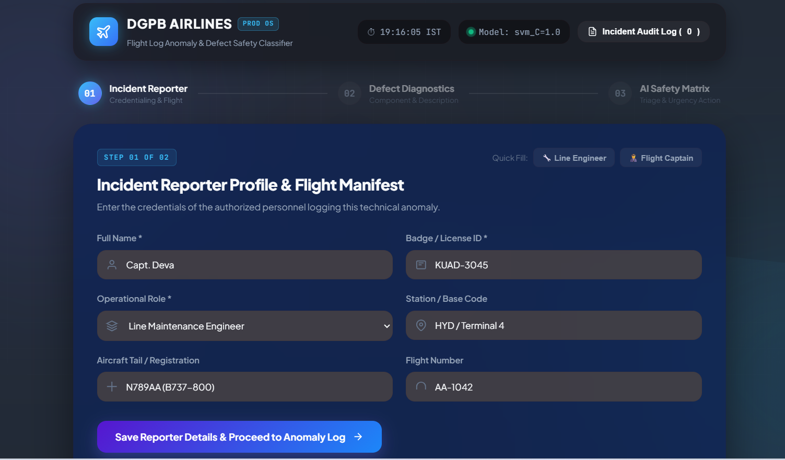
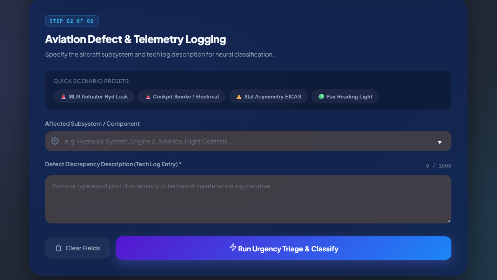
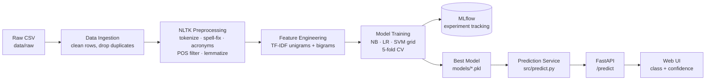

<div align="center">

# ✈️ AIRLINE SAFTEY REPORT SYSTEM

### Aircraft Maintenance Log Urgency Classifier

*An end-to-end NLP pipeline that reads free-text aircraft maintenance logs and classifies their urgency, with a confidence score, through a REST API and a web interface.*


</div>

---

## 📑 Table of Contents

1. [Overview](#-overview)
2. [Problem Statement](#-problem-statement)
3. [Key Features](#-key-features)
4. [Demo](#-demo)
5. [System Architecture](#-system-architecture)
6. [Tech Stack](#-tech-stack)
7. [Project Structure](#-project-structure)
8. [Dataset](#-dataset)
9. [NLP Preprocessing Pipeline](#-nlp-preprocessing-pipeline)
10. [Modeling & Experiment Tracking](#-modeling--experiment-tracking)
11. [Confidence Score](#-confidence-score)
12. [Getting Started](#-getting-started)
13. [Usage](#-usage)
14. [API Reference](#-api-reference)
15. [Configuration](#-configuration)
16. [Docker Deployment](#-docker-deployment)
17. [Results](#-results)
18. [Limitations](#-limitations)
19. [Roadmap](#-roadmap)
20. [Troubleshooting](#-troubleshooting)
21. [Author](#-author)

---

## 📌 Overview

Every day, aircraft technicians write hundreds of maintenance log entries in short, abbreviated and often misspelled free text, for example:

> `hyd lk at MLG actuator, beyond limits, found on walkaround`

Deciding how urgent each entry is can be a matter of flight safety. **AeroTriage** automates this first-level triage. It:

1. **Cleans** the raw technician text using NLTK (tokenization, spelling correction, aviation acronym expansion, POS tagging and lemmatization).
2. **Converts** the text into numerical features with TF-IDF.
3. **Trains and compares** multiple classifiers (Naive Bayes, Logistic Regression and Linear SVM) across different hyperparameters, with every experiment tracked in MLflow.
4. **Serves** the best model through a FastAPI backend and a web UI that shows the predicted urgency and a **confidence score**.

Each log is classified into one of three urgency levels:

| Urgency | Meaning | Typical action |
|---|---|---|
| 🟢 **Routine** | Minor defect, within limits | Fix at the next scheduled check; the aircraft can be released |
| 🟠 **Ground Aircraft** | Defect beyond limits | Do not release the aircraft; rectify before the next flight |
| 🔴 **Immediate Safety Hazard** | Active danger (fire, smoke, loss of control) | Stop operations and alert the safety team immediately |

<!-- > ⚠️ **Disclaimer:** AeroTriage is a **decision-support tool** built for learning and demonstration. It does not replace certified engineers, approved maintenance data or regulatory procedures. -->

---

## ❓ Problem Statement

Maintenance logs are:

- **Unstructured:** free text, not form fields
- **Noisy:** typos (`hydralic`, `leek`), shorthand (`hyd`, `eng`, `MLG`, `inop`)
- **Ambiguous:** the same word (`leak`) can be routine or critical depending on context (`minor` vs `streaming`)
- **High volume:** manual review is slow and inconsistent between shifts

**Goal:** build a reproducible, explainable and deployable NLP system that flags log urgency consistently and tells the user how confident it is, so uncertain cases can be sent for human review.

---

## ✨ Key Features

- 🧹 **Domain-aware NLP preprocessing** with NLTK, including a configurable aviation acronym dictionary and a spelling correction map
- 🏷️ **POS tagging** to keep the words that describe components and failures (nouns, verbs, adjectives)
- 🤖 **Multi-model training:** Naive Bayes, Logistic Regression and Linear SVM, each with several hyperparameter values
- 📊 **Robust evaluation:** deduplication, stratified 5-fold cross-validation, train/test gap analysis for overfitting
- 📈 **Experiment tracking** with MLflow (parameters and metrics for every run)
- 🎯 **Confidence scores** for every prediction (SVM probabilities are calibrated)
- ⚠️ **Low-confidence flag** that recommends human review
- ⚡ **FastAPI REST service** with automatic Swagger docs
- 🎨 **Responsive web UI** with color-coded urgency and a large confidence display
- 🐳 **Dockerized** for one-command deployment
- ⚙️ **Config-driven:** paths, preprocessing, features and model grids all live in YAML files

---

## 🖥️ Demo
[Live](https://flight-log-anomaly-incident-report-parser.onrender.com)

<p align="center">
  
  
</p>

> To add your own screenshot, create a `docs/` folder and save the image as `docs/screenshot.png`.

**Example**

| Input | Prediction | Confidence |
|---|---|---|
| `smoke at electrical panel, fire risk, reported by crew` | 🔴 Immediate Safety Hazard | high |
| `crack at eng 2, exceeds AMM limits` | 🟠 Ground Aircraft | high |
| `noise at pax seat, monitor next check` | 🟢 Routine | high |
| `LH brake overheat after landing` | depends on training data | lower (ambiguous) |

---

## 🏗️ System Architecture



**Training flow:** `data_ingestion → preprocessing → feature_engineering → train`
**Inference flow:** `UI → FastAPI → predict → (same preprocessing) → vectorizer → model → response`

> The **same** `clean_text()` function is used in training and inference. This prevents *training–serving skew*.

---

## 🧰 Tech Stack

| Layer | Technology |
|---|---|
| Language | Python 3.11 |
| Package / env manager | [uv](https://docs.astral.sh/uv/) |
| NLP | NLTK |
| Machine learning | scikit-learn |
| Data handling | pandas, NumPy |
| Experiment tracking | MLflow (SQLite backend) |
| Backend API | FastAPI + Uvicorn |
| Frontend | HTML, CSS, vanilla JavaScript (Jinja2 template) |
| Configuration | YAML |
| Serialization | joblib |
| Containerization | Docker, Docker Compose |

---

## 📁 Project Structure

```
aviation-urgency-classifier/
│
├── configs/
│   ├── config.yaml              # File paths, MLflow and logging settings
│   ├── params.yaml              # Preprocessing, TF-IDF and model hyperparameters
│   └── acronyms.yaml            # Aviation acronyms + spelling corrections
│
├── data/
│   ├── raw/                     # Input CSV (maintenance_logs.csv)
│   └── processed/               # Cleaned dataset (generated)
│
├── src/
│   ├── __init__.py
│   ├── logger.py                # Console + file logging
│   ├── utils.py                 # YAML loader, NLTK resource downloader
│   ├── data_ingestion.py        # Load CSV, remove empty/duplicate rows
│   ├── preprocessing.py         # NLTK text cleaning pipeline
│   ├── feature_engineering.py   # TF-IDF vectorizer
│   ├── train.py                 # Multi-model training + CV + MLflow
│   └── predict.py               # Inference with confidence scores
│
├── app/
│   ├── main.py                  # FastAPI application
│   ├── templates/
│   │   └── index.html           # Web UI
│   └── static/
│       ├── style.css
│       └── script.js
│
├── models/                      # Saved best model, vectorizer, model info (generated)
├── notebooks/
│   └── eda.ipynb                # Exploratory data analysis
├── logs/                        # Application logs (generated)
├── mlruns/                      # MLflow tracking store (generated)
│
├── make_realistic_data.py       # Synthetic dataset generator
├── check_data.py                # Duplicate / leakage diagnostics
├── explain_data.py              # Feature-leakage and top-word analysis
├── hard_test.py                 # Hand-written "real-world" sanity tests
│
├── Dockerfile
├── docker-compose.yml
├── pyproject.toml               # Dependencies (managed by uv)
├── uv.lock
├── .python-version
├── .gitignore
├── .dockerignore
└── README.md
```

---

## 📊 Dataset

**Location:** `data/raw/aviation_maintenance_logs.csv`

| Column | Type | Description | Used for training |
|---|---|---|---|
| `log_id` | string | Unique log identifier | ❌ |
| `date` | date | Date the defect was recorded | ❌ |
| `aircraft_type` | string | e.g. A320, B737, ATR72 | ❌ |
| `tail_number` | string | Aircraft registration (e.g. VT-ABC) | ❌ |
| `reported_by` | string | Technician, pilot or cabin crew | ❌ |
| `ata_chapter` | int | ATA system chapter (e.g. 29 = Hydraulics) | ❌ |
| `component` | string | Affected component | ✅ (joined with description) |
| `description` | text | Free-text defect description | ✅ |
| `urgency` | label | **Target:** Routine / Ground Aircraft / Immediate Safety Hazard | 🎯 |

### Synthetic data

Real airline maintenance logs are confidential, so this project includes a **realistic synthetic data generator** (`make_realistic_data.py`). It deliberately copies real-world messiness:

- The **same symptom** (e.g. *leak*) appears in **all three classes** with different probabilities
- Only **~60%** of logs contain an explicit severity hint (*minor*, *beyond limits*, *severe*)
- **~15%** of severity hints are vague or misleading
- **~5% label noise** to simulate engineers disagreeing
- Random **typos** and **abbreviations**
- The **component does not decide the label**, which prevents feature leakage

> 💡 **Lesson learned:** a first version of the data, generated by an AI assistant, produced **100% accuracy for every model**. Diagnostics (`check_data.py`, `explain_data.py`) showed the classes were separable by single keywords. Too-perfect scores usually point to a data problem, not a great model.

---

## 🧹 NLP Preprocessing Pipeline

Implemented in `src/preprocessing.py` using **NLTK**:

| # | Step | Tool | Example |
|---|---|---|---|
| 1 | Lowercasing and whitespace cleanup | `re` | `Hyd  LEAK` → `hyd leak` |
| 2 | Sentence tokenization | `nltk.sent_tokenize` | `Leak found. Reported by crew.` → 2 sentences |
| 3 | Word tokenization | `nltk.word_tokenize` | `leak found` → `["leak", "found"]` |
| 4 | Spelling correction | dictionary (`acronyms.yaml`) | `hydralic` → `hydraulic` |
| 5 | Acronym expansion | dictionary (`acronyms.yaml`) | `mlg` → `main landing gear` |
| 6 | POS tagging and filtering | `nltk.pos_tag` | keep `NN*`, `VB*`, `JJ*`, `RB*` |
| 7 | Stop-word removal | NLTK stopwords | removes `the`, `at`, `on` |
| 8 | Lemmatization | `WordNetLemmatizer` | `leaks` → `leak`, `found` → `find` |

**Protected words:** negations and limit words (`no`, `not`, `within`, `beyond`, `above`, `below`) are **always kept**, because *"within limits"* and *"beyond limits"* mean opposite things.

**Example**

```
Input : Hydralic fluid leek found at MLG actuator, beyond limits
Output: hydraulic fluid leak find main landing gear actuator beyond limit
```

---

## 🤖 Modeling & Experiment Tracking

### Feature engineering
- **TF-IDF** vectorizer with unigrams and bigrams (`ngram_range: [1, 2]`), up to 5,000 features

### Models and hyperparameter grid (`configs/params.yaml`)

| Model | Hyperparameter | Values tried |
|---|---|---|
| Multinomial Naive Bayes | `alpha` | 0.1, 0.5, 1.0 |
| Logistic Regression | `C` | 0.1, 1.0, 10.0 |
| Linear SVM (calibrated) | `C` | 0.1, 1.0, 10.0 |

Logistic Regression and SVM use `class_weight="balanced"` to handle class imbalance (safety hazards are rarer).

### Evaluation strategy

1. **Deduplication** of identical cleaned texts, so the same log can't appear in both train and test (prevents leakage)
2. **Stratified 80/20 train–test split**
3. **Stratified 5-fold cross-validation** on the training set, using a `Pipeline(TF-IDF → model)` so the vectorizer is re-fit inside each fold
4. **Metrics:** weighted F1 (primary), accuracy, train F1, test F1
5. **Overfitting check:** `gap = train_f1 − test_f1` (above ~0.10 suggests overfitting)

### Model selection
The best model is the one with the **highest mean CV F1**. On a tie, the one with the **lower standard deviation** (more stable) wins. The untouched test set is used only for the final report.

### MLflow
Every run logs:
- **Params:** model name, hyperparameter value, TF-IDF settings
- **Metrics:** `cv_f1_mean`, `cv_f1_std`, `train_f1`, `test_f1`, `test_accuracy`, `overfit_gap`

---

## 🎯 Confidence Score

Every prediction returns a probability for **each class**. The **confidence** is the probability of the predicted class.

- **Naive Bayes / Logistic Regression:** native `predict_proba`
- **Linear SVM:** wrapped in `CalibratedClassifierCV`, because LinearSVC only outputs distances from the decision boundary, not probabilities
- **Low-confidence flag:** raised when confidence is below **0.50** (configurable via `LOW_CONFIDENCE` in `src/predict.py`) or when none of the input words were seen during training

> Naive Bayes is known to be **over-confident**. Logistic Regression and calibrated SVM usually give more trustworthy probabilities.

---

## 🚀 Getting Started

### Prerequisites

- Python **3.11**
- [uv](https://docs.astral.sh/uv/getting-started/installation/)
- (Optional) [Docker Desktop](https://www.docker.com/products/docker-desktop/)

### 1. Clone the repository

```bash
git clone https://github.com/<your-username>/aviation-urgency-classifier.git
cd aviation-urgency-classifier
```

### 2. Install dependencies

```bash
uv sync
```

This creates a `.venv` and installs everything from `uv.lock`.

### 3. Add data

Place your dataset at `data/raw/maintenance_logs.csv`, **or** generate synthetic data:

```bash
uv run python make_realistic_data.py
```

> Required NLTK resources are downloaded automatically on first run.

---

## 🧪 Usage

> Run all commands from the **project root**.

| Step | Command | What it does |
|---|---|---|
| 1 | `uv run python -m src.data_ingestion` | Loads and validates the data |
| 2 | `uv run python -m src.preprocessing` | Shows NLTK cleaning on sample sentences |
| 3 | `uv run python -m src.train` | Trains all models, logs to MLflow, saves the best one |
| 4 | `uv run mlflow ui --backend-store-uri sqlite:///mlruns/mlflow.db` | Opens the experiment dashboard at http://127.0.0.1:5000 |
| 5 | `uv run python -m src.predict` | Runs sample predictions in the terminal |
| 6 | `uv run python hard_test.py` | Tests the model on hand-written tricky logs |
| 7 | `uv run uvicorn app.main:app --reload` | Starts the web app at http://127.0.0.1:8000 |

**Interactive API docs (Swagger):** http://127.0.0.1:8000/docs

---

## 📡 API Reference

### `POST /predict`

Classifies a maintenance log.

**Request**
```json
{
  "component": "Electrical",
  "description": "smoke at electrical panel, fire risk, reported by crew"
}
```

| Field | Type | Required | Description |
|---|---|---|---|
| `description` | string | ✅ | Free-text defect description |
| `component` | string | ❌ | Affected component |

**Response `200 OK`**
```json
{
  "urgency": "Immediate Safety Hazard",
  "confidence": 0.8712,
  "probabilities": {
    "Ground Aircraft": 0.0934,
    "Immediate Safety Hazard": 0.8712,
    "Routine": 0.0354
  },
  "low_confidence": false,
  "keywords": ["electrical", "panel", "smoke", "fire", "risk"],
  "cleaned_text": "electrical panel smoke electrical panel fire risk report crew"
}
```

**Response `400 Bad Request`**: empty description
```json
{ "detail": "Description cannot be empty" }
```

**cURL**
```bash
curl -X POST http://127.0.0.1:8000/predict \
  -H "Content-Type: application/json" \
  -d '{"component": "Engine", "description": "crack at eng 2, exceeds AMM limits"}'
```

### `GET /model-info`
Returns the deployed model's name, CV F1 score and class labels.

### `GET /health`
Health check. Returns `{"status": "ok"}`.

### `GET /`
Serves the web UI.

---

## ⚙️ Configuration

All behavior is controlled through YAML, so no code changes are needed.

**`configs/config.yaml`**: paths and tracking
```yaml
data:
  raw_path: data/raw/aviation_maintenance_logs.csv
  processed_path: data/processed/clean_logs.csv
model:
  model_path: models/best_model.pkl
  vectorizer_path: models/vectorizer.pkl
mlflow:
  tracking_uri: sqlite:///mlruns/mlflow.db
  experiment_name: aviation-urgency-classifier
```

**`configs/params.yaml`**: experiments
```yaml
features:
  max_features: 5000
  ngram_range: [1, 2]
models:
  naive_bayes:
    alpha: [0.1, 0.5, 1.0]
  logistic_regression:
    C: [0.1, 1.0, 10.0]
  svm:
    C: [0.1, 1.0, 10.0]
```
To try more settings, add values to these lists and run `src.train` again.

**`configs/acronyms.yaml`**: domain dictionary
```yaml
acronyms:
  hyd: hydraulic
  mlg: main landing gear
spelling:
  hydralic: hydraulic
  leek: leak
```

---

## 🐳 Docker Deployment

> Train the model first (`uv run python -m src.train`). The image packages the files in `models/`.

```bash
docker compose up --build
```

The app will be available at **http://127.0.0.1:8000**.

| File | Purpose |
|---|---|
| `Dockerfile` | Python 3.11 slim image, installs dependencies with uv, downloads NLTK data, runs Uvicorn |
| `docker-compose.yml` | Builds the image, maps port 8000 and mounts `logs/` |
| `.dockerignore` | Excludes `.venv`, raw data, notebooks and MLflow runs from the image |

---

## 📈 Results

> Fill in this table with the values from your latest MLflow run.

| Model | Best param | CV F1 (mean ± std) | Test F1 | Train–Test gap |
|---|---|---|---|---|
| Naive Bayes | alpha = `<x>` | `<0.xx ± 0.xx>` | `<0.xx>` | `<0.xx>` |
| Logistic Regression | C = `<x>` | `<0.xx ± 0.xx>` | `<0.xx>` | `<0.xx>` |
| Linear SVM (calibrated) | C = `<x>` | `<0.xx ± 0.xx>` | `<0.xx>` | `<0.xx>` |

**Selected model:** `<model_name>`

> Because ~40% of logs carry no severity hint and ~5% of labels are noisy by design, the realistic upper limit on the synthetic dataset is roughly **0.75–0.80 F1**. Scores near 1.0 would indicate leakage.

---

## ⚠️ Limitations

- Trained on **synthetic data**; performance on real airline logs is unknown
- **Bag-of-words** features ignore word order beyond bigrams (e.g. "no leak found" vs "leak found")
- Spelling correction is **dictionary-based**, so unseen typos are not corrected
- Classifies only from text; it does not use aircraft history, MEL status or regulations
- Not certified for operational use

---

## 🗺️ Roadmap

- [ ] Train and validate on real (anonymized) maintenance logs
- [ ] Add transformer-based models (e.g. fine-tuned BERT) for comparison
- [ ] Explainability: highlight the words that drove each prediction
- [ ] Batch classification by CSV upload
- [ ] Log every prediction for monitoring and data-drift detection
- [ ] CI/CD pipeline with automated tests (pytest + GitHub Actions)
- [ ] Register models in the MLflow Model Registry

---

## 🛠️ Troubleshooting

| Problem | Solution |
|---|---|
| `ModuleNotFoundError: No module named 'src'` | Run from the project root using `python -m src.<module>` |
| `LookupError: Resource punkt_tab not found` | `uv run python -c "from src.utils import download_nltk_data; download_nltk_data()"` |
| `FileNotFoundError: models/best_model.pkl` | Train first: `uv run python -m src.train` |
| `FileNotFoundError: data/raw/aviation_maintenance_logs.csv` | Add your CSV |
| UI looks unstyled / old | Hard-refresh the browser with **Ctrl + F5** |
| Port 8000 already in use | `uv run uvicorn app.main:app --port 8001` |

<!-- ---

## 🤝 Contributing

Contributions are welcome.

1. Fork the repository
2. Create a feature branch: `git checkout -b feature/your-feature`
3. Commit your changes: `git commit -m "Add your feature"`
4. Push the branch: `git push origin feature/your-feature`
5. Open a Pull Request

---

## 📄 License

This project is licensed under the **MIT License**. See the `LICENSE` file for details.

--- -->

## 👤 Author

**Deva Manikanta**

- GitHub: [@ Deva Manikanta](https://github.com/pachava-Deva-Manikanta)
- LinkedIn: [Deva Manikanta](https://www.linkedin.com/in/deva-manikanta)

---

<div align="center">

⭐ If you found this project useful, consider giving it a star!

</div>
